# nux

**An SSH client, port forwarder and code editor for your phone.**
Terminals, file browsers, editors, git and port forwardings all open as Chrome-style tabs that keep their state,
grouped into workspaces. Built with Flutter; Android first.

<p>
  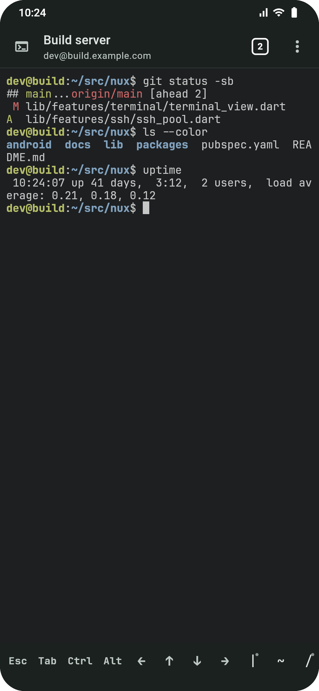
  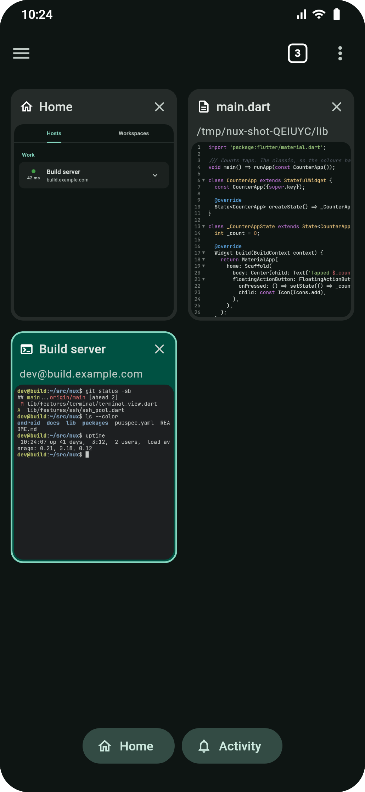
  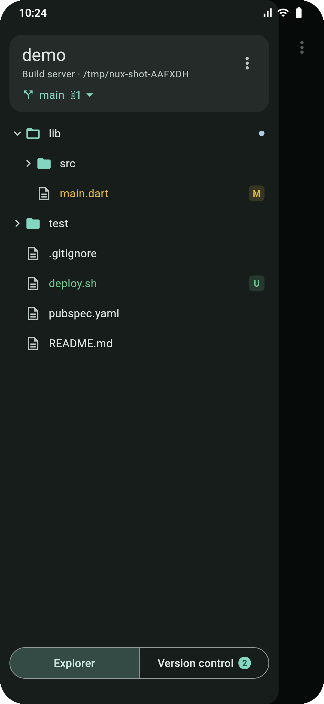
  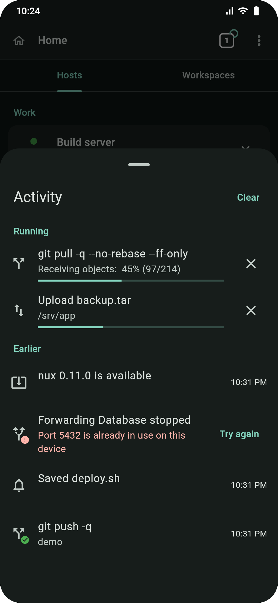
</p>

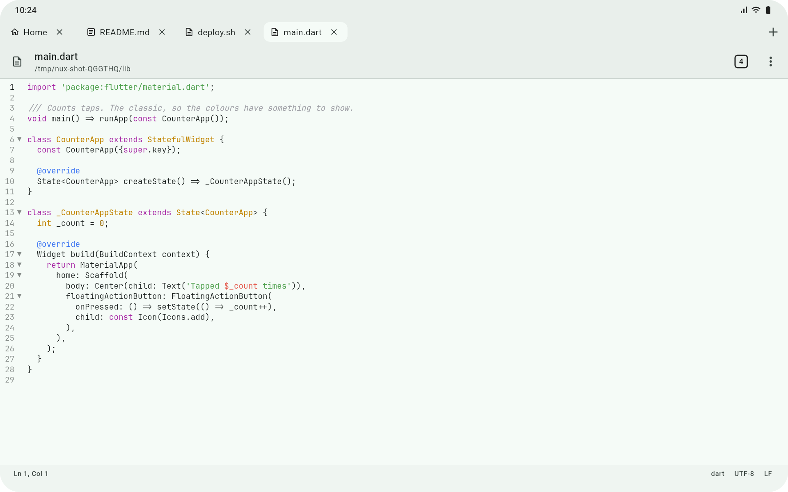

## Features

### Tabs and workspaces
- Everything is a tab: terminals, file browsers, editors, a web browser and Home (hosts and workspaces).
  Tabs survive restarts; terminals and transfers keep running in the background.
- A tab overview with animated cards: swipe a card away to close it, pin tabs, close all, reopen the last
  closed. On wide screens a tab strip sits on top.
- **Workspaces**: a folder on a host with its own set of tabs, a project tree, Quick open (fuzzy file
  search) and Search in files.
- **Activity**: one sheet for what nux is doing and what happened: git fetch / pull / push with live
  progress, uploads and downloads, forwardings that stopped, dropped connections, updates. Cancel what
  runs, retry what failed.

### SSH and terminal
- Saved hosts with groups and colours, jump hosts, password or key sign-in, host key checking (trust on
  first use, warns when a key changes), a live ping for each host.
- A fast terminal with selection, copy and paste, pinch to change the text size, and links you can open.
- **Extra keys** above the keyboard: presets with one or two rows, or your own layout made by drag and
  drop. Hold a key to repeat it, long-press for alternates (`(` → `()`, `&` → `&&`), lock Ctrl or Alt.
- Long-press a path in the output (`src/app.py:40` from grep or a compiler) to open it in the editor at
  that line.
- **SSH keys**: generate Ed25519, ECDSA or RSA keys, import OpenSSH, PEM and PuTTY keys, install a key on
  a server, export it as text or a QR code. A key can ask for the device unlock before it is used.

### Files
- An SFTP file browser: sort, hidden files, bookmarks, rename, move, permissions, delete, multi-select.
- Uploads and downloads with progress, resumable after a dropped connection; whole folders both ways.
- **Share to nux** from any app to upload files to a host; **Open with nux** opens text files of other apps
  in the editor; Share sends a file from nux to other apps.

### Editor
- Syntax highlighting for many languages, line numbers, folding, word wrap, find and replace (case, regex),
  go to line, auto-indent and bracket pairs.
- Encodings and line endings (read and save as), a status bar with the cursor position, Markdown preview,
  images, and a hex view for binary files.
- Notices when the file changed on the server and shows the difference before you overwrite it.
  **Save as root** through sudo when your user may not write a file.

### Git
- Status of the workspace with staged and unstaged changes; stage whole files or single parts of a diff.
- Unified or side-by-side diffs, commit (amend, sign-off), branches (switch with stash or carry, create,
  rename, delete), fetch, pull (explains diverged branches), push with a preview of the commits, and
  force-with-lease when a push is rejected.
- History with a branch graph, commit details, blame, stash, tags.
- A conflict resolver (yours / theirs / both per block) with Continue and Abort for merges, rebases,
  cherry-picks and reverts.
- Sign-in for HTTPS remotes (an access token works as the password); the credentials reach git through its
  input, never a command line or a file. Every action can show the git command that does the same.

<p>
  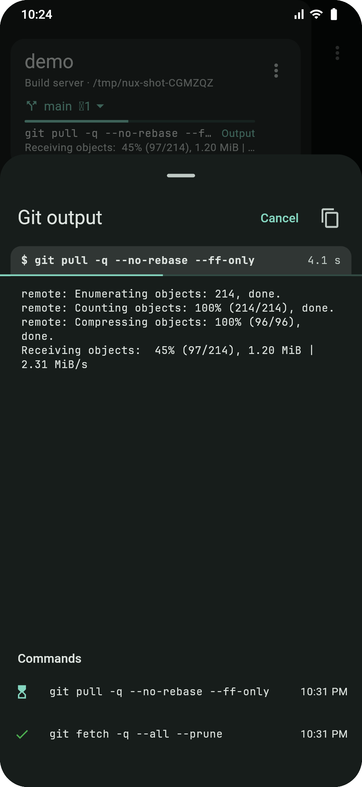
  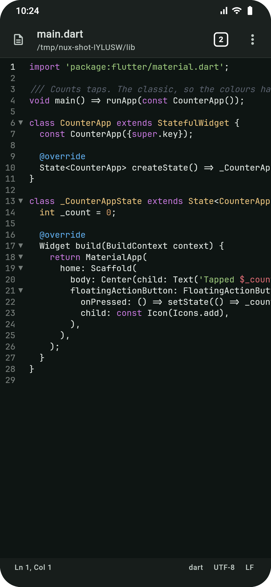
  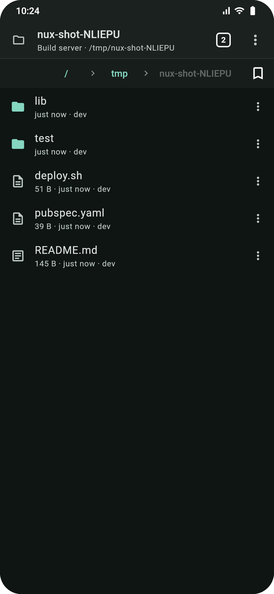
  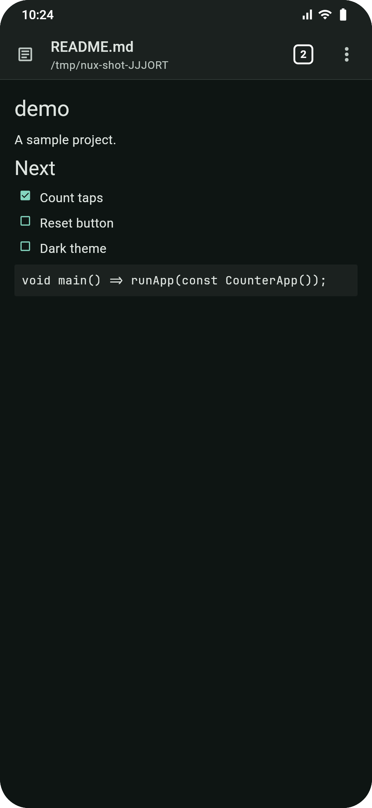
</p>

### Port forwarding
- Local (`-L`), remote (`-R`) and dynamic SOCKS (`-D`) forwardings over SSH, attached to their host and
  shown under it on Home with live traffic.
- TCP and UDP forwardings over **ZeroTier** with the ZeroTier node built in (no ZeroTier app needed).
- Start with nux, reconnect after a drop, reachable from the LAN if you want, and open a forwarded web port
  in a browser tab.

<p>
  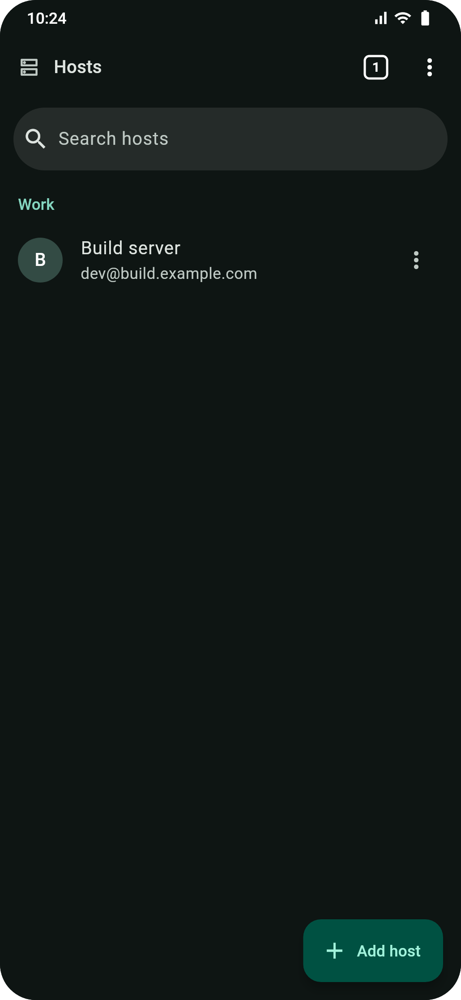
  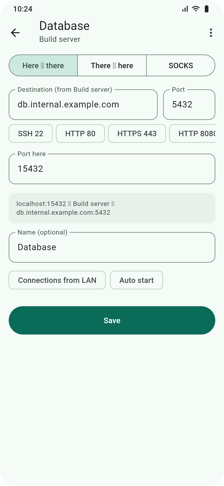
  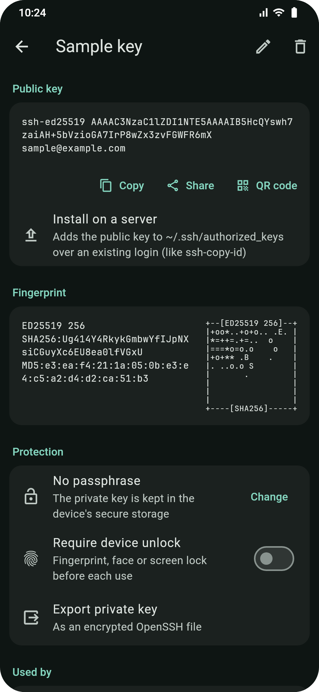
  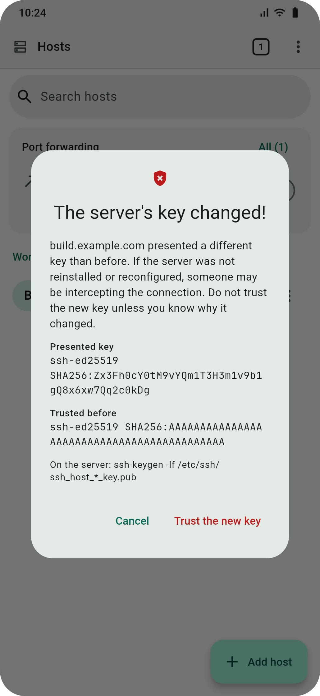
</p>

### Settings
- Light and dark themes, English and Russian.
- Terminal and editor colour schemes, four bundled monospace fonts, text size and line spacing, with
  previews.
- Export and restore settings, a log you can read, filter and share (hosts masked, secrets never logged),
  and in-app updates from the GitHub releases.

<p>
  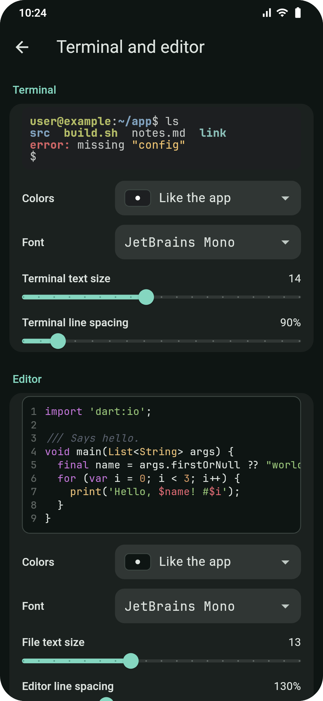
  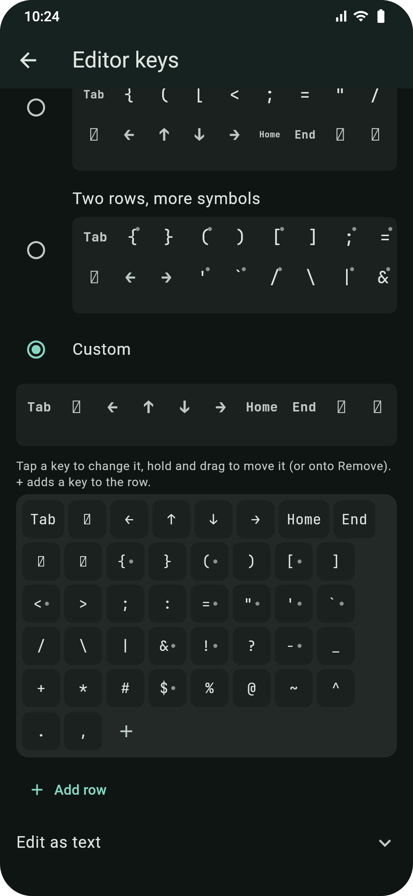
  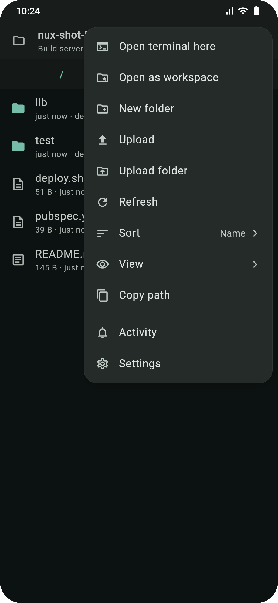
  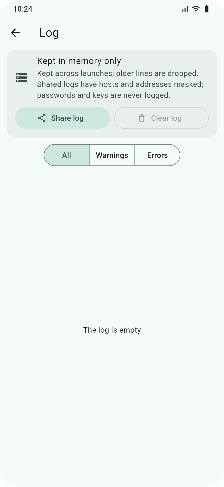
</p>

### On a tablet

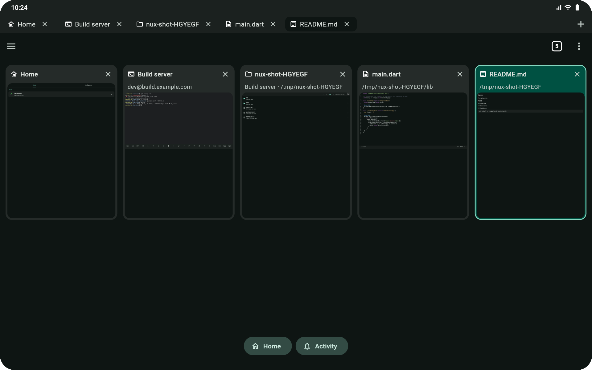

## Privacy and security

- Passwords, passphrases, private keys and tokens live only in the platform's secure storage; nothing
  secret is written to the database, the log or a command line.
- No accounts, no analytics. nux talks to your hosts, your ZeroTier networks, and GitHub to check for
  updates (which you can turn off).

## Install

Download the APK from [Releases](https://github.com/nuc134r/nux/releases): `arm64-v8a` for most phones,
or the universal APK. nux updates itself from there. What changed is in [`CHANGELOG.md`](CHANGELOG.md).

## Build

```bash
fvm install            # the Flutter version from .fvmrc
fvm flutter pub get
fvm flutter run
```

The ZeroTier library is compiled from source during the build, which needs git, CMake and the Android NDK.
[`CLAUDE.md`](CLAUDE.md) has the conventions and commands, [`docs/PLAN.md`](docs/PLAN.md) the design
decisions, [`TODO.md`](TODO.md) what is next, and [`docs/RELEASING.md`](docs/RELEASING.md) how releases are
made. Screenshots come from `bash tool/screenshots.sh`.

## License

[MIT](LICENSE). Bundled fonts: JetBrains Mono ([OFL](assets/fonts/OFL.txt)), Fira Code
([OFL](assets/fonts/FiraCode-LICENSE.txt)), Hack ([MIT / Bitstream Vera](assets/fonts/Hack-LICENSE.md)) and
Source Code Pro ([OFL](assets/fonts/SourceCodePro-LICENSE.md)).
